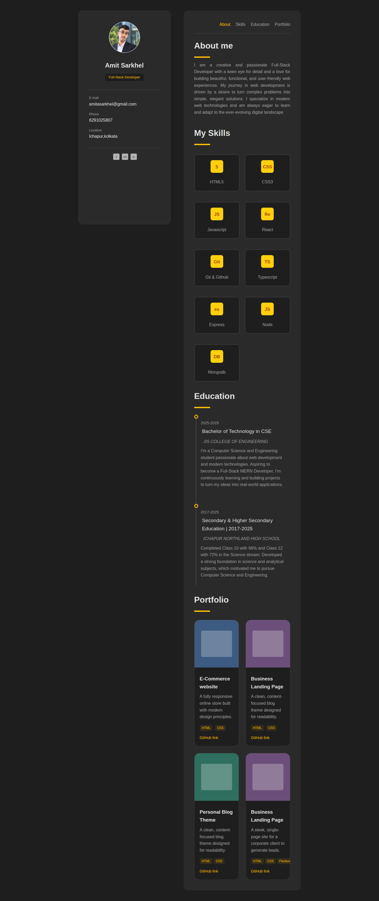
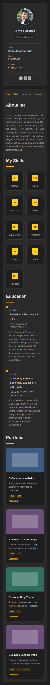

# Personal Portfolio Website

**Internship:** Oasis Infobyte (OIBSIP)
**Track / Level / Task:** Web Development & Designing, Level 1, Task 2 (Personal Portfolio)
**Folder:** `OIBSIP/WebDev-L1-Portfolio/`

A responsive personal portfolio website that presents my profile, skills, projects and contact details, like a digital résumé.

## Tech Stack

- HTML5 (page structure)
- CSS3 (layout, colours, responsive design)
- JavaScript (optional, only if used): [remove this line if you did not use JS]
- Fonts: [Google Font name(s) you used]

## Feature Checklist

| # | Requirement | Status | Where to find it |
|---|-------------|--------|------------------|
| 1 | Profile/hero section with name, role title and photo or avatar | Done | Hero section at the top of `index.html` |
| 2 | About Me section (2–3 sentences about background and interests) | Done | About section |
| 3 | Skills section as a visual grid or list | Done | Skills section |
| 4 | Projects section with at least 2 cards (title, description, GitHub link) | Done | Projects section |
| 5 | Contact section with name, email and LinkedIn/GitHub links | Done | Contact section |
| 6 | Smooth scroll navigation between sections | Done | Nav links use `#section-id` anchors with `scroll-behavior: smooth` in `style.css` |
| 7 | Consistent branding (colour scheme and font family) | Done | Same colours and fonts used across all sections |
| 8 | Fully responsive on desktop and mobile | Done | Media queries in `style.css` |

## Sections

1. **Home / Hero:** name, role title and profile photo or avatar
2. **About Me:** short introduction
3. **Skills:** [list your skills, e.g. HTML, CSS, JavaScript, Git]
4. **Projects:** [Project 1 name], [Project 2 name]
5. **Contact:** email, LinkedIn and GitHub

## How to Run

Open `index.html` in any browser. No installation or build step is needed.

## Live Demo

[Live Demo link: add your GitHub Pages URL here]

## Screenshots

**Desktop**

**Mobile**

## Author

Amit Sarkhel (update spelling if needed)
JIS College of Engineering
GitHub: https://github.com/amitasarkhel-svg
LinkedIn: https://www.linkedin.com/in/amit-sarkhel-052155367/