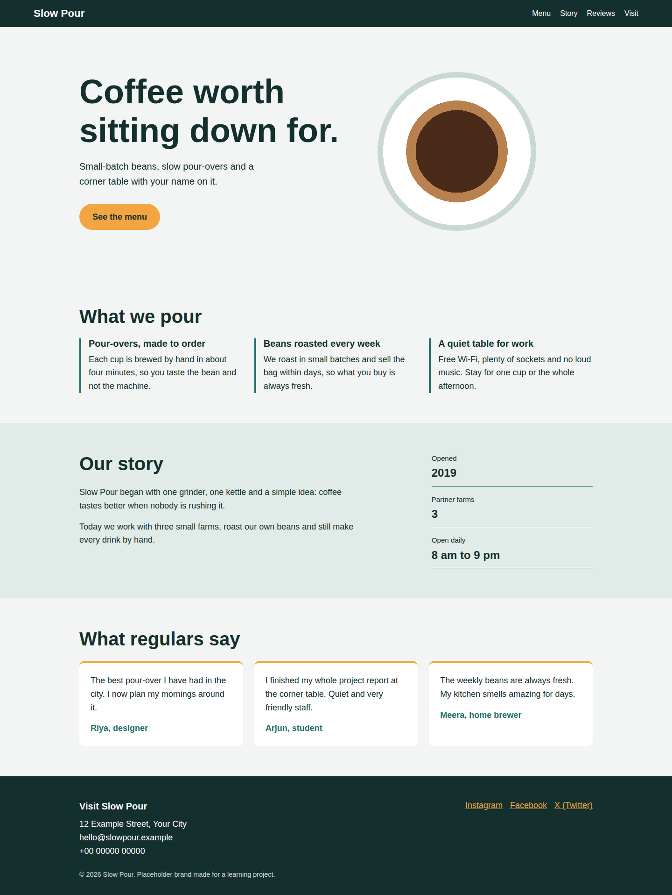
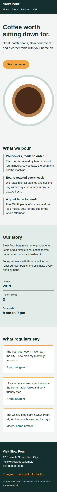

# Slow Pour Coffee: Landing Page

**Internship:** Oasis Infobyte (OIBSIP)
**Track / Level / Task:** Web Development & Designing, Level 1, Task 1 (Landing Page)
**Folder:** `OIBSIP/WebDev-L1-LandingPage/`

A static, responsive landing page for a made-up coffee bar called *Slow Pour*.

## Tech Stack

- HTML5 (page structure)
- CSS3 (Flexbox, Grid, media queries, CSS variables)
- No JavaScript (as the task requires)
- Google Fonts: Bricolage Grotesque (headings) and Karla (body)

## Feature Checklist

| # | Requirement | Status | Where to find it |
|---|-------------|--------|------------------|
| 1 | Fixed or sticky navigation bar with at least 3 links | Done | `.navbar` uses `position: sticky`; 4 links (Menu, Story, Reviews, Visit) |
| 2 | Hero with headline, subheadline and call-to-action button | Done | `.hero`: `h1`, `.subheadline`, `.btn` |
| 3 | At least 2 distinct content sections | Done | Features (`#menu`), About (`#story`), Testimonials (`#reviews`) |
| 4 | Footer with placeholder contact and social links | Done | `.footer` with address, email, phone, 3 social links |
| 5 | Consistent colour palette | Done | 5 colours defined once in `:root` and reused everywhere |
| 6 | Responsive layout (Flexbox or Grid) | Done | Grid and Flexbox, plus one `@media (min-width: 800px)` rule |
| 7 | No element overlap; padding, margin and box-sizing set on purpose | Done | `* { box-sizing: border-box; margin: 0; padding: 0; }` and no horizontal scroll at 375px |
| 8 | Readable typography with at least 2 font sizes | Done | Large headings (`h1`, `h2`, `h3`) and 18px body text |

## How to Run

Open `index.html` in any browser. No install or build step is needed.

## Live Demo

[Live Demo link: add your GitHub Pages URL here]

## Screenshots

**Desktop**

**Mobile**

## Author

Amit Sarkhel (update spelling if needed)
JIS College of Engineering
GitHub: https://github.com/amitasarkhel-svg
LinkedIn: https://www.linkedin.com/in/amit-sarkhel-052155367/